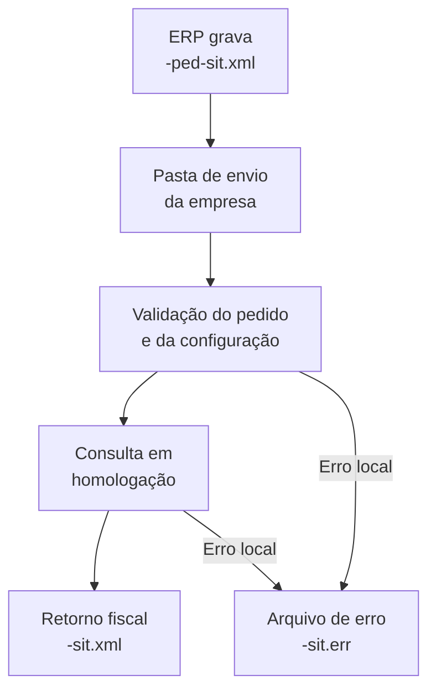

# Consulta de protocolo da NF-e ABI

A consulta de protocolo verifica a situação de uma NF-e ABI pela chave de acesso. Ela não autoriza o documento nem gera um XML processado ou de distribuição.

O serviço está disponível somente em homologação. Pedidos em produção não são transmitidos.

## Pré-requisitos

- Configure a empresa e as pastas de envio e retorno no UniNFe.
- Use homologação (`tpAmb` igual a `2`) no XML e na configuração da empresa.
- Configure um certificado digital válido quando a empresa utilizar certificado.
- Configure o proxy quando a rede exigir.

## Arquivo de envio

Grave o pedido na pasta de envio da empresa como `<identificador>-ped-sit.xml`. Use um identificador único para cada consulta.

O XML deve ter a raiz `consSitNFeABI`, o namespace `http://www.portalfiscal.inf.br/nfeabi`, a versão `1.00`, `xServ` igual a `CONSULTAR` e uma chave de acesso de 44 dígitos do modelo `77` em `chNFeABI`.

```xml
<?xml version="1.0" encoding="utf-8"?>
<consSitNFeABI xmlns="http://www.portalfiscal.inf.br/nfeabi" versao="1.00">
  <tpAmb>2</tpAmb>
  <xServ>CONSULTAR</xServ>
  <chNFeABI>41260912345678000123770010000000011012345670</chNFeABI>
</consSitNFeABI>
```

Veja também o [modelo de consulta no repositório](https://github.com/Unimake/Uninfe/blob/main/exemplos%20xml/NFeAbi/consSitNFeABI-ped-sit.xml).

## Fluxo de processamento

1. O ERP grava `<identificador>-ped-sit.xml` na pasta de envio.
2. O UniNFe valida o pedido, o ambiente e o certificado quando utilizado.
3. O UniNFe consulta o serviço em homologação e grava o XML original da resposta como `<identificador>-sit.xml` na pasta de retorno.
4. Após gravar o retorno, o pedido é removido. Em caso de falha local, o UniNFe grava `<identificador>-sit.err` e mantém o pedido para nova tentativa após a correção.



## Arquivos envolvidos

| Momento | Pasta | Nome do arquivo |
|---|---|---|
| Pedido de consulta | Pasta de envio | `<identificador>-ped-sit.xml` |
| Retorno fiscal | Pasta de retorno | `<identificador>-sit.xml` |
| Erro local | Pasta de retorno | `<identificador>-sit.err` |

O ERP deve analisar o retorno fiscal, principalmente `cStat` e `xMotivo`. O arquivo `.err` usa o formato de erro do UniNFe e informa a categoria da falha sem expor o conteúdo original da exceção. Verifique os dados do pedido, o ambiente, o certificado e a conexão antes de tentar novamente.
