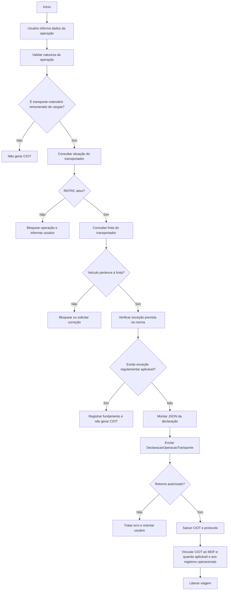
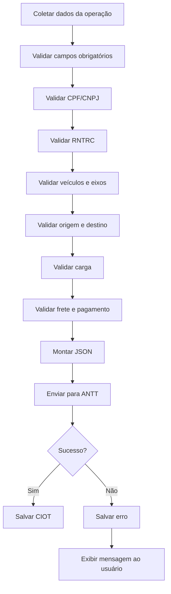
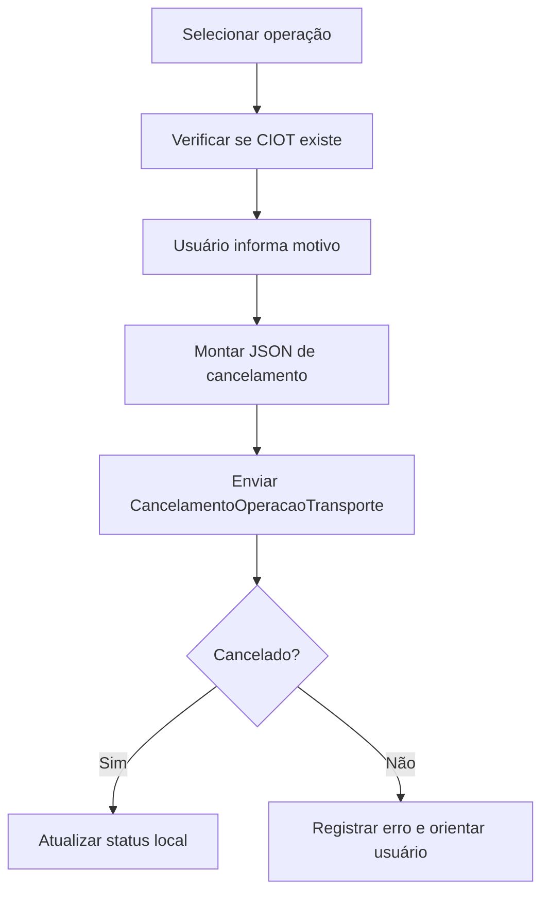
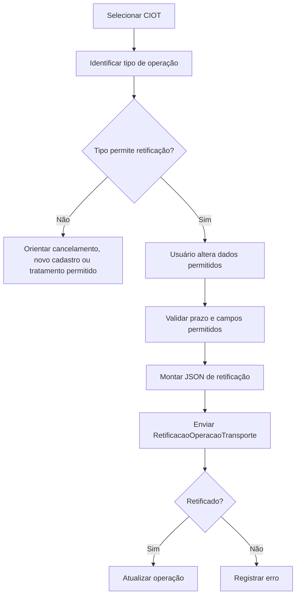
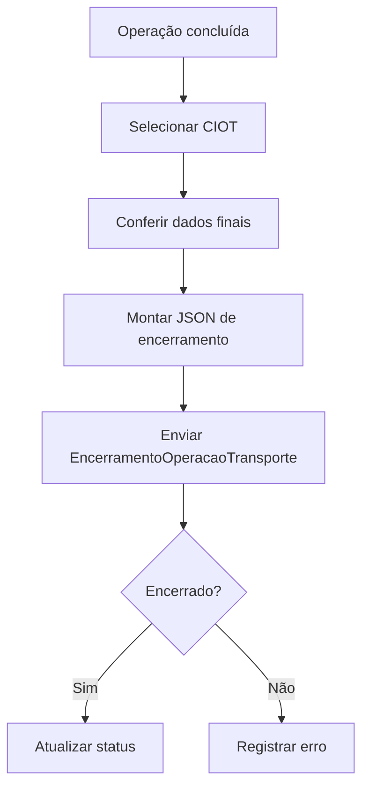

# CIOT ANTT — Guia de integração para desenvolvedores

> **Objetivo:** orientar a implementação da integração direta com a ANTT para geração, consulta, retificação, cancelamento e encerramento do CIOT.
>
> **Público-alvo:** desenvolvedores de ERP, TMS, emissores de CT-e/MDF-e e sistemas de gestão de transporte.
>
> **Base principal:** [Documento de Contrato de Serviço (DCS) PEF v1.2](https://www.gov.br/antt/pt-br/assuntos/cargas/ciot-para-todos-1/dcs_pef_v1-2.pdf), Portaria SUROC nº 6/2026 e Perguntas Frequentes da ANTT.
>
> **Última revisão:** 23/11/2026.

---

## 1. Resumo executivo

O **CIOT** é o **Código Identificador da Operação de Transporte**. Ele identifica uma operação de transporte rodoviário remunerado de cargas perante a ANTT.

Na prática, o CIOT funciona como um registro oficial da operação de transporte, contendo informações como contratante, contratado, veículo, carga, origem, destino, valor do frete, forma de pagamento e dados necessários para controle do piso mínimo de frete, quando aplicável.

Este documento trata principalmente da integração direta com a ANTT, sem perder de vista que a forma de geração depende do cenário operacional:

| Cenário | Forma de geração conforme a regra operacional |
|---|---|
| Contratação ou subcontratação de **TAC** ou **TAC equiparado** | Por **Instituição de Pagamento autorizada** a gerar CIOT. |
| Operação efetivamente realizada por **ETC não equiparada a TAC**, sem subcontratação de TAC/TAC equiparado | Pela própria ETC, por integração ao Web Service da ANTT ou por Instituição de Pagamento autorizada. |
| Transporte de **carga própria**, sem prestação remunerada de serviço a terceiros e sem pagamento de frete | Em regra, não exige CIOT. |

### Pontos mais importantes para o desenvolvedor

- A integração atual do DCS é por **Web Service RESTful**.
- A troca de mensagens é em **JSON**, não XML.
- A comunicação exige **HTTPS/TLS com autenticação por certificado digital ICP-Brasil**.
- O certificado deve ser **ICP-Brasil A1 ou A3**, observando os requisitos técnicos do DCS e a autorização de acesso aplicável ao ambiente.
- A ANTT disponibiliza ambiente de **homologação** e **produção** para os integradores autorizados.
- O sistema precisa implementar serviços de consulta, declaração, cancelamento, retificação, encerramento e consulta de exceção, conforme o DCS vigente.
- A geração do CIOT deve ocorrer **antes do início da operação de transporte**.
- O CIOT deve ser persistido no sistema, informado e vinculado ao **MDF-e quando houver MDF-e aplicável à operação**, e mantido coerente com CT-e, NFS-e, nota fiscal, contrato, ordem de serviço e demais documentos operacionais existentes.

---

## 2. O que é CIOT

CIOT significa **Código Identificador da Operação de Transporte**.

Ele é um código gerado a partir do cadastramento de uma operação de transporte rodoviário remunerado de cargas no sistema da ANTT.

De forma simples: quando alguém contrata transporte rodoviário de carga, a operação precisa ser registrada na ANTT, e esse registro gera o CIOT.

O CIOT permite que a ANTT acompanhe:

- quem contratou o transporte;
- quem executou o transporte;
- qual veículo foi utilizado;
- qual carga foi transportada;
- origem e destino;
- valor do frete;
- forma de pagamento;
- enquadramento da operação;
- aderência ao piso mínimo de frete, quando aplicável.

---


## ⚠️ Atualização importante — realidade operacional do mercado (2026)

A integração direta com a ANTT existe, mas **não substitui totalmente** as Instituições de Pagamento autorizadas. A forma de geração do CIOT depende do transportador que efetivamente executa a operação e da existência ou não de TAC/TAC equiparado na cadeia.

### Integração direta com a ANTT NÃO substitui totalmente as Instituições de Pagamento

| Cenário operacional | Forma prática/regulatória |
|---|---|
| **Contratante ou subcontratante contrata TAC ou TAC equiparado** | Geração por **Instituição de Pagamento autorizada** a gerar CIOT. |
| **ETC não equiparada a TAC, com mais de três veículos no RNTRC, realiza diretamente a operação, sem TAC/TAC equiparado** | Geração pela própria ETC por integração ao Web Service da ANTT **ou** por Instituição de Pagamento autorizada. |
| **ETC subcontrata outra ETC não equiparada a TAC, e a subcontratada efetivamente realiza o transporte** | A responsabilidade pelo registro tende a recair sobre a ETC que efetivamente realizará o transporte, observadas as regras de cadastramento. |
| **Carga própria, sem transporte remunerado para terceiros** | Em regra, não há obrigação de gerar CIOT. |

Isso significa que:

> A integração direta com a ANTT atende principalmente operações em que uma ETC não equiparada a TAC efetivamente realiza a prestação remunerada de transporte, com veículo regularmente vinculado à sua frota no RNTRC, sem subcontratar TAC ou TAC equiparado.

Já operações envolvendo TAC/TAC equiparado continuam utilizando Instituição de Pagamento autorizada para geração do CIOT.

### Outro ponto operacional importante

Para geração do `IdOperacaoTransporte` utilizado no fluxo da ANTT, atualmente existem duas opções práticas disponibilizadas:

1. `GeradorCIOTShared.dll`
2. `GeradorCIOT.exe`

Em ambas as opções, é informado o:

- CNPJ do contratado, quando aplicável ao fluxo da ETC que efetivamente realiza a operação.

E o retorno será:

- ID da operação de transporte / ID do CIOT.

### Impacto importante para desenvolvedores

Nem todos os ambientes conseguem consumir DLL .NET diretamente.

Exemplo comum:

- Visual FoxPro
- xHarbour/Harbour
- Delphi legado
- integrações nativas Win32

Nestes cenários, o `GeradorCIOT.exe` pode ser o caminho mais viável, se essa opção estiver disponível no pacote técnico vigente da ANTT.

### Conclusão arquitetural importante

O sistema NÃO deve assumir:

```text
CIOT = somente integração direta ANTT
```

O correto é assumir:

```text
CIOT = múltiplos provedores possíveis
```

Exemplo:

```text
Motor CIOT
 ├── ANTT
 ├── Instituição de Pagamento autorizada A
 ├── Instituição de Pagamento autorizada B
 ├── Instituição de Pagamento autorizada C
 └── outros provedores futuros autorizados
```


## 3. O que mudou em 2026

A página oficial da ANTT informa que a geração do CIOT passou a ser obrigatória para as operações de transporte rodoviário remunerado de cargas, observadas as exceções previstas na regulamentação vigente.

A ampliação da obrigatoriedade de cadastro do CIOT começou em **24/05/2026**. A [Resolução ANTT nº 6.090/2026](https://anttlegis.antt.gov.br/action/ActionDatalegis.php?acao=detalharAto&cod_menu=5408&cod_modulo=161&numeroAto=00006090&orgao=DG%2FANTT%2FMT&seqAto=000&tipo=RES&valorAno=2026) fixou **18/09/2026** para o registro previsto na nova redação do art. 7º, § 15, da Lei nº 13.703/2018, sem interromper ou afastar a obrigação anterior. Novas funcionalidades que dependam de regulamentação ou implementação técnica seguem o cronograma de ato específico.

### Quitação do frete

A [Lei nº 15.485/2026](https://www.planalto.gov.br/ccivil_03/_ato2023-2026/2026/lei/l15485.htm) estabelece **até 30 dias úteis para quitar o frete**. O [Comunicado Geral SUROC nº 1/2026](https://anttlegis.antt.gov.br/action/ActionDatalegis.php?acao=abrirTextoAto&cod_menu=9230&cod_modulo=623&numeroAto=00000001&orgao=SUROC%2FANTT%2FMT&seqAto=000&tipo=COM&valorAno=2026) esclarece: contratações novas desde **06/08/2026**; operações sob contratos anteriores a partir de **05/11/2026**, ressalvadas operações já concluídas e direitos adquiridos. A regra alcança TAC, ETC e CTC e vale também na subcontratação, para cada contratante em relação à sua obrigação. A ANTT informou que as funcionalidades específicas do novo modelo de CIOT para forma e prazo de quitação ainda não estavam disponíveis. Até ato próprio, mantenha o fluxo vigente, controle o prazo no ERP/TMS e guarde contratos, documentos fiscais e comprovantes de liquidação. Não confunda os campos de pagamento já existentes no DCS com a implantação do novo modelo.

Isso significa que, para sistemas de transporte, ERP, TMS e emissores de documentos fiscais eletrônicos, o CIOT deixou de ser tratado apenas como uma obrigação pontual para TAC/TAC equiparado e passou a fazer parte do fluxo normal de contratação e execução do transporte rodoviário remunerado de cargas.

### Impacto prático

O sistema precisa passar a perguntar, calcular, registrar e transmitir dados que antes poderiam não existir de forma estruturada.

Exemplos:

- tipo da operação de transporte: carga lotação, carga fracionada ou TAC-agregado;
- dados do contratado e do contratante ou, em subcontratação, do subcontratado e subcontratante;
- situação do RNTRC;
- veículos, implementos e eixos da composição veicular;
- dados de origem e destino, preferencialmente no maior nível de especificidade disponível;
- dados de carga;
- valor do frete;
- forma de pagamento;
- dados bancários, PIX ou instituição de pagamento, conforme o tipo de pagamento;
- indicação e justificativa de contingência, quando admitida;
- cancelamento, retificação ou encerramento, conforme o tipo de operação e os prazos aplicáveis.

Também é importante separar duas análises:

1. **Obrigatoriedade do CIOT:** decorre da existência de transporte rodoviário remunerado de cargas por conta de terceiros.
2. **Validação do piso mínimo:** aplica-se conforme os requisitos da Política Nacional de Pisos Mínimos do Transporte Rodoviário de Cargas, especialmente quando a operação também se enquadrar como carga lotação nos termos da Resolução ANTT nº 5.867/2020.

## 4. CIOT, PEF e RNTRC — diferença entre os conceitos

### CIOT

É o código que identifica a operação de transporte perante a ANTT.

O sistema gera o CIOT ao declarar a operação de transporte.

### PEF

PEF significa **Pagamento Eletrônico de Frete**.

É o conjunto de regras e mecanismos relacionados ao pagamento eletrônico do frete, especialmente quando há TAC, TAC equiparado ou situações reguladas pela ANTT.

### RNTRC

RNTRC significa **Registro Nacional de Transportadores Rodoviários de Cargas**.

É o cadastro do transportador perante a ANTT. O RNTRC identifica se o transportador está ativo e em qual categoria ele está enquadrado, como TAC, ETC ou CTC.

---

## 5. Quem é quem no CIOT

### TAC

**TAC** é o **Transportador Autônomo de Cargas**.

Em linguagem simples, é o caminhoneiro autônomo, pessoa física, que presta serviço de transporte rodoviário remunerado de cargas.

Características comuns:

- pessoa física;
- possui RNTRC;
- presta serviço de transporte mediante remuneração;
- não é empregado formal do contratante;
- pode ser contratado por embarcador, transportadora ou outro contratante.

### TAC equiparado

**TAC equiparado** é uma pessoa jurídica que, para fins de determinadas regras da ANTT, recebe tratamento parecido com o TAC.

Na prática, normalmente envolve ETCs com frota pequena, especialmente até três veículos registrados no RNTRC.

Para o sistema, o ponto importante é: **não tente decidir isso apenas por cadastro local**. Use o serviço `ConsultarSituacaoTransportador`, pois a ANTT retorna se o transportador é ou não equiparado ao TAC.

### ETC

**ETC** é a **Empresa de Transporte Rodoviário de Cargas**.

É a transportadora pessoa jurídica que presta serviço de transporte rodoviário remunerado de cargas e possui registro no RNTRC.

Exemplos:

- transportadora com frota própria;
- empresa que emite CT-e;
- empresa que transporta carga de terceiros mediante remuneração.

### CTC

**CTC** é a **Cooperativa de Transporte Rodoviário de Cargas**.

É uma cooperativa formada por transportadores para prestação de serviço de transporte.

### Embarcador

O **embarcador** é, em regra, o dono da carga ou quem contrata o transporte da carga.

Exemplos:

- indústria que contrata uma transportadora;
- distribuidora que contrata um TAC;
- empresa comercial que contrata transporte para entregar mercadorias;
- transportadora que subcontrata um TAC para executar parte da operação.

### Contratante

É quem contrata o serviço de transporte e, normalmente, quem assume a responsabilidade de registrar o CIOT quando a regra exige.

### Contratado

É quem executará o transporte.

Pode ser:

- TAC;
- TAC equiparado;
- ETC;
- CTC.

---

## 6. Quem deve gerar o CIOT

A regra prática para sistemas é:

> **A responsabilidade pela geração do CIOT depende de quem foi contratado, de quem efetivamente realizará a operação e de haver ou não contratação de TAC/TAC equiparado na operação que está sendo registrada.**

Com as regras de 2026, o CIOT passa a atingir de forma ampla as operações de prestação de serviço de transporte rodoviário remunerado de cargas, mas a forma de geração não é igual em todos os cenários.

### Regra operacional por cenário

| Cenário | Responsável operacional pela geração | Meio de geração |
|---|---|---|
| Contratante contrata **TAC** | Contratante | Instituição de Pagamento autorizada. |
| Contratante contrata **TAC equiparado** | Contratante, com possibilidade de delegação operacional nos casos admitidos | Instituição de Pagamento autorizada. |
| Transportadora subcontrata **TAC** ou **TAC equiparado** | Transportadora subcontratante | Instituição de Pagamento autorizada. |
| **ETC não equiparada a TAC** efetivamente realiza a operação, sem subcontratar TAC/TAC equiparado | A própria ETC que realiza a operação | Integração ao Web Service da ANTT ou Instituição de Pagamento autorizada. |
| ETC subcontrata outra **ETC não equiparada a TAC** que efetivamente realiza o transporte | A ETC subcontratada que efetivamente realiza o transporte | Integração ANTT ou Instituição de Pagamento autorizada, conforme o caso. |
| Transporte de **carga própria**, sem prestação remunerada a terceiros | Não há geração de CIOT, em regra | Não aplicável. |

### Cenários comuns

#### 6.1 Embarcador contrata TAC

O embarcador deve gerar o CIOT por meio de Instituição de Pagamento autorizada.

Exemplo: uma indústria contrata diretamente um caminhoneiro autônomo para levar mercadoria de Paranavaí para Curitiba.

#### 6.2 Embarcador contrata TAC equiparado

O embarcador deve gerar o CIOT por meio de Instituição de Pagamento autorizada.

Havendo acordo entre as partes, a obrigação operacional de cadastramento e geração pode ser delegada à ETC equiparada a TAC ou à CTC contratada, quando a regulamentação admitir. Essa delegação **não afasta a responsabilidade do contratante** pelas obrigações e penalidades.

#### 6.3 Transportadora subcontrata TAC

A transportadora subcontratante deve gerar o CIOT por meio de Instituição de Pagamento autorizada.

Exemplo: a transportadora recebeu uma carga do embarcador, mas subcontratou um autônomo para executar a viagem.

#### 6.4 ETC executa a operação diretamente

Quando a ETC não é equiparada a TAC, possui mais de três veículos no RNTRC e efetivamente realiza a operação sem subcontratar TAC/TAC equiparado, a própria ETC é responsável pelo registro.

Nesse caso, a geração pode ocorrer:

- por integração direta ao Web Service da ANTT; ou
- por Instituição de Pagamento autorizada.

O veículo automotor informado na operação deve estar regularmente vinculado à frota da ETC no RNTRC.

#### 6.5 Transporte de carga própria

Aqui é necessário cuidado.

Se a empresa transporta mercadoria própria, com veículo próprio ou sob sua posse, sem prestação remunerada de serviço de transporte a terceiros e sem pagamento de frete, a situação não exige geração de CIOT.

Por outro lado, **frota própria não significa automaticamente carga própria**. Se a empresa transporta carga de terceiros mediante remuneração, existe prestação de serviço de transporte rodoviário remunerado de cargas, e o CIOT deve ser avaliado e gerado conforme a regra aplicável.

O sistema não deve presumir CIOT sem analisar:

- se existe prestação de serviço de transporte;
- se existe frete contratado;
- se há terceiro contratante;
- se há TAC, TAC equiparado, ETC ou CTC na execução;
- se há CT-e, MDF-e, NFS-e, nota fiscal, contrato ou outro documento idôneo;
- se a operação se enquadra como transporte rodoviário remunerado de cargas.

Para evitar erro, crie uma validação de negócio no ERP/TMS perguntando se a operação é:

- transporte próprio;
- transporte contratado;
- subcontratação;
- redespacho;
- prestação de serviço de transporte para terceiros;
- transporte intramunicipal remunerado;
- operação com ou sem MDF-e aplicável.

## 7. Quando gerar o CIOT

O CIOT deve ser gerado **antes do início da operação de transporte**.

No sistema, o ponto ideal para gerar o CIOT é antes de:

- autorizar a viagem;
- liberar o carregamento;
- encerrar a emissão do MDF-e;
- disponibilizar o contrato de transporte;
- enviar o motorista para coleta.

### Regra de ouro para o ERP/TMS

> Não deixe o usuário iniciar a viagem se a operação exige CIOT e o CIOT ainda não foi gerado.

### Sugestão de validação no sistema

Antes de liberar a viagem, valide:

1. existe operação de transporte remunerado?
2. existe transportador contratado?
3. o transportador possui RNTRC?
4. a frota está vinculada ao transportador?
5. a operação está em exceção?
6. o valor do frete está informado?
7. a forma de pagamento está informada?
8. a operação exige CIOT?
9. o CIOT já foi gerado?
10. o CIOT está vinculado ao MDF-e, quando aplicável, e coerente com CT-e, NFS-e, nota fiscal, contrato ou ordem de serviço existentes?

---

## 8. Forma de integração com a ANTT

A integração descrita no DCS da ANTT é por **Web Service RESTful com JSON**.

Apesar de a documentação usar o termo “WebService”, tecnicamente o consumo descrito é uma API HTTP no padrão RESTful.

### Resposta direta

**É Webservice ou API?**

É um **Web Service RESTful**, consumido por HTTP/HTTPS, com troca de mensagens em JSON.

### Não é SOAP/XML

A documentação analisada **não descreve integração SOAP**, **não usa XML como payload principal** e **não apresenta WSDL/XSD**.

O DCS informa expressamente que a troca de mensagens ocorre no padrão RESTful com JSON e métodos POST ou GET.

Portanto, para a implementação atual, o desenvolvedor deve trabalhar com:

- HTTPS;
- TLS/mTLS;
- certificado digital de cliente;
- JSON;
- POST/GET;
- DTOs de entrada e saída;
- validação de campos por regra de negócio.

---

## 9. Endereços dos serviços

O DCS v1.2, na última página, informa os seguintes endereços de serviço. Substitua `{nomeDoServico}` pelo serviço e use o verbo HTTP que o DCS especifica:

| Ambiente | URL |
|---|---|
| Homologação | `https://appservices-hml.antt.gov.br/pefServices/api/{nomeDoServico}` |
| Produção | `https://appservices.antt.gov.br/pefServices/api/{nomeDoServico}` |

### Observação importante

O DCS também informa, nos exemplos de mensagens, que no momento da implementação pode ser necessário solicitar à ANTT o **host e contexto**.

Na prática, isso significa que:

- a URL base está publicada;
- as rotas finais dos métodos devem ser confirmadas no material técnico atualizado, biblioteca oficial ou junto à ANTT;
- o integrador deve validar em homologação antes de liberar em produção.

---

## 10. WSDL e XSD

### Existe WSDL?

Pelo DCS analisado, **não**.

A integração descrita não é SOAP, portanto não há WSDL como ocorre em muitos webservices fiscais tradicionais.

### Existe XSD?

Pelo DCS analisado, **não**.

Como a troca de mensagens é em JSON, não há XSD para validação XML.

### Como validar então?

A validação deve ser feita por:

- DTOs/classes fortemente tipadas;
- validações de obrigatoriedade;
- validações de tamanho;
- validações de domínio;
- validações de tipo;
- validações de regras de negócio descritas no DCS;
- retorno oficial da ANTT.

### Sugestão para a DLL/API

Crie internamente **validadores de DTO** antes de enviar para a ANTT.

Exemplo:

```csharp
public sealed class DeclaracaoOperacaoTransporteValidator
{
    public ValidationResult Validate(DeclaracaoOperacaoTransporteRequest request)
    {
        // Validar CPF/CNPJ
        // Validar RNTRC
        // Validar valor do frete
        // Validar datas
        // Validar veículos
        // Validar origem/destino
        // Validar pagamento
        // Validar campos conforme TipoOperacao
    }
}
```

---

## 11. Certificado digital e acesso

A integração exige certificado digital.

### Tipo de certificado

O DCS informa que o certificado deve observar, no mínimo:

- padrão ICP-Brasil;
- tipo A1 ou A3;
- requisitos técnicos definidos no DCS;
- uso compatível com autenticação do cliente no canal HTTPS/TLS;
- autorização/cadastramento para acesso ao ambiente correspondente, quando exigido pela ANTT.

### Qualquer certificado A1 acessa?

Não para consumo efetivo do serviço.

Um certificado A1 válido, sozinho, não comprova que o titular pode declarar a operação. Verifique a identidade do CNPJ, o RNTRC, o vínculo da frota, o papel do transportador e as regras do DCS. O DCS também admite A3.

### Para baixar documentação precisa certificado?

Não necessariamente.

A página pública da ANTT disponibiliza documentos técnicos e ferramentas. O certificado é necessário para consumo dos serviços protegidos.

### Para homologação precisa certificado?

Sim.

O DCS informa que os requisitos de segurança também são exigidos no ambiente de homologação.

### A ETC precisa solicitar uma nova habilitação para produção?

A [página de documentos técnicos da ANTT](https://www.gov.br/antt/pt-br/assuntos/cargas/ciot-para-todos-1/documentos-tecnicos) informa que as ETCs já estão cadastradas para uso dos serviços de CIOT. Para ETC elegível, valide certificado, RNTRC, frota e acesso ao ambiente adequado; não confunda essa checagem com o credenciamento da instituição de pagamento para gerar CIOT.

A página oficial informa que, nas operações efetivamente realizadas por ETC com mais de três veículos, a geração pode ocorrer por integração ao Web Service da ANTT ou via Instituição de Pagamento autorizada. Nas operações com TAC ou TAC equiparado, a geração deve ocorrer por Instituição de Pagamento autorizada.

## 12. Serviços do Web Service PEF

O DCS PEF v1.2 descreve sete serviços. `ConsultarExcecao` foi removido da especificação; não dependa desse serviço em novas integrações. A existência do modelo legado no UniNFe não garante que a ANTT continue atendendo a chamada.

### 12.1 ConsultarSituacaoTransportador

Consulta a situação do transportador no RNTRC.

Use para descobrir:

- se o RNTRC está ativo;
- se o transportador é TAC, ETC ou CTC;
- se é equiparado ao TAC.

#### Entrada principal

```json
{
  "CpfCnpjInteressado": "string",
  "CpfCnpjTransportador": "string",
  "RNTRCTransportador": "string"
}
```

#### Saída principal

```json
{
  "CpfCnpjTransportador": "string",
  "RNTRCTransportador": "string",
  "NomeRazaoSocialTransportador": "string",
  "RNTRCAtivo": true,
  "TipoTransportador": "string",
  "EquiparadoTAC": true,
  "Mensagem": "string",
  "Protocolo": "string",
  "Codigo": "string"
}
```

### 12.2 ConsultarFrotaTransportador

Consulta se uma ou mais placas pertencem à frota do transportador.

Use antes de gerar CIOT para evitar rejeição.

#### Entrada principal

```json
{
  "CpfCnpjInteressado": "string",
  "CpfCnpjTransportador": "string",
  "RNTRCTransportador": "string",
  "Placas": [
    "string"
  ]
}
```

#### Saída principal

```json
{
  "CpfCnpjTransportador": "string",
  "RNTRCTransportador": "string",
  "NomeRazaoSocialTransportador": "string",
  "RNTRCAtivo": true,
  "Mensagem": "string",
  "Protocolo": "string",
  "Codigo": "string",
  "Frota": [
    {
      "PlacaVeiculo": "string",
      "SituacaoVeiculoFrotaTransportador": 0
    }
  ]
}
```

### 12.3 DeclaracaoOperacaoTransporte

Este é o serviço principal para gerar o CIOT.

Ele registra a operação de transporte e retorna o código de identificação da operação e o código verificador.

#### Campos importantes

- `IdOperacaoTransporte`
- `TipoOperacao`
- `CpfCnpjContratado`
- `RNTRCContratado`
- `CpfCnpjContratante`
- `RNTRCContratante`
- `CpfCnpjDestinatario`
- `ValorFrete`
- `DataDeclaracao`
- `IndContingencia`
- `DataInicioViagem`
- `DataFimViagem`
- `Veiculos`
- `OrigemDestino`
- `DadosCarga`
- `InfPagamento`
- `InfIndicadoresOperacionais`

#### TipoOperacao

| Código | Significado |
|---:|---|
| 1 | Carga lotação |
| 2 | Carga fracionada |
| 3 | TAC-agregado |

#### Exemplo simplificado de entrada

```json
{
  "IdOperacaoTransporte": "string",
  "TipoOperacao": 1,
  "CpfCnpjContratado": "string",
  "RNTRCContratado": "string",
  "CpfCnpjContratante": "string",
  "RNTRCContratante": "string",
  "CpfCnpjDestinatario": "string",
  "ValorFrete": 0.00,
  "DataDeclaracao": "2026-05-25T10:00:00",
  "IndContingencia": false,
  "JustificativaContingencia": null,
  "DataInicioViagem": "2026-05-25",
  "DataFimViagem": "2026-05-26",
  "Veiculos": [
    {
      "Placa": "ABC1D23",
      "RNTRCVeiculo": "string",
      "NumeroEixos": "2"
    }
  ],
  "OrigemDestino": [
    {
      "Origem": {
        "CodigoMunicipioOrigem": 4118402,
        "CepOrigem": "87700000"
      },
      "Destino": {
        "CodigoMunicipioDestino": 4106902,
        "CepDestino": "80000000"
      },
      "DistanciaPercorrida": 500
    }
  ],
  "DadosCarga": {
    "CodigoNaturezaCarga": 0,
    "PesoCarga": 1000.00,
    "CodigoTipoCarga": 5
  },
  "InfPagamento": [
    {
      "TipoPagamento": 6,
      "ChavePix": "string",
      "CpfCnpjCreditado": "string",
      "IndPagamento": 0
    }
  ],
  "InfIndicadoresOperacionais": {
    "IndAltoDesempenho": false,
    "IndRetornoVazio": false,
    "ComposicaoVeicular": false
  }
}
```

> Exemplo didático; não use como requisição pronta. No DCS v1.2, `IdentificadorPix` deixou de ser obrigatório e `CodigoNaturezaCarga` tem tamanho 4 (B9/B69). Para origem e destino, confira as regras B124–B127. Use localizações reais e o mesmo tipo nos dois lados do par: se o código IBGE se repete, use CEPs distintos ou coordenadas; se o CEP se repete ou não é reconhecido, use as coordenadas de origem e destino.

#### Saída principal

```json
{
  "CodigoIdentificacaoOperacao": "string",
  "CodigoVerificador": "string",
  "Protocolo": "string",
  "Codigo": "string",
  "Mensagem": "string",
  "AvisoTransportador": "string"
}
```

O leiaute acima usa `CodigoIdentificacaoOperacao` (12 caracteres); o exemplo JSON do próprio DCS apresenta `IdOperacaoTransporte`. Valide o retorno do ambiente e preserve separadamente o código verificador e o protocolo.

### 12.4 CancelamentoOperacaoTransporte

Cancela uma operação de transporte que ainda não foi realizada.

#### Entrada principal

```json
{
  "CodigoIdentificacaoOperacao": "string",
  "MotivoCancelamento": "string"
}
```

#### Saída principal

```json
{
  "CodigoIdentificacaoOperacao": "string",
  "DataCancelamento": "2026-05-25T10:00:00",
  "Protocolo": "string",
  "Codigo": "string",
  "Mensagem": "string"
}
```

### 12.5 RetificacaoOperacaoTransporte

Retifica dados de uma operação já declarada **somente quando o tipo de operação e a regra operacional permitirem**.

Pontos importantes:

- operações de **carga lotação** não devem ser tratadas como retificáveis no fluxo comum; inconsistências devem seguir o procedimento adequado de cancelamento, novo cadastro ou outro tratamento previsto no DCS vigente;
- operações de **carga fracionada** podem admitir retificação até a data de encerramento, conforme regras operacionais;
- operações do tipo **TAC-agregado** possuem regras próprias de retificação e encerramento;
- as possibilidades concretas de retificação dependem do DCS e da regulamentação vigente.

Use a retificação apenas para dados permitidos e dentro dos prazos admitidos.

#### Entrada principal

```json
{
  "CodigoIdentificacaoOperacao": "string",
  "ValorFrete": 0.00,
  "DataFimViagem": "2026-05-26",
  "OrigemDestino": [
    {
      "Origem": {
        "CodigoMunicipioOrigem": 4118402,
        "CepOrigem": "87700000"
      },
      "Destino": {
        "CodigoMunicipioDestino": 4106902,
        "CepDestino": "80000000"
      }
    }
  ],
  "DadosCarga": {
    "CodigoNaturezaCarga": 0,
    "PesoCarga": 1000.00,
    "CodigoTipoCarga": 5
  }
}
```

> Atenção: o exemplo acima é didático. Antes de habilitar retificação no produto, valide o tipo de operação, o prazo e os campos permitidos no DCS oficial vigente.

### 12.6 EncerramentoOperacaoTransporte

Encerra uma operação de transporte.

Use quando a operação foi concluída.

Não confunda a duração da operação com seu encerramento. As regras B21/B30 do DCS tratam do intervalo entre início e fim (limite geral de 90 dias, limitado a 30 no TAC-agregado). Para TAC-agregado, a B123 valida que o fim informado na declaração não é anterior ao início mais 10 dias; a B116 (315) rejeita o encerramento antes de completados 10 dias do início. Os demais prazos dependem do tipo da operação e da Portaria vigente.

### 12.7 ConsultarCIOTGerado

Consulta o CIOT gerado. No DCS v1.2, envie `CodigoIdentificacaoOperacao` com 12 caracteres; `AnoDeclaracao` é opcional. A saída documentada pode trazer o código com o verificador, totalizando 16 caracteres.

Use quando precisar recuperar o código de identificação da operação e o dígito verificador.

---

## 13. Fluxo principal de implementação



---

## 14. Fluxo de geração do CIOT



---

## 15. Fluxo de cancelamento



---

## 16. Fluxo de retificação




## 17. Fluxo de encerramento



---

## 18. Sugestão de arquitetura para Codex implementar

### Camadas sugeridas

```text
Unimake.CIOT
├── Domain
│   ├── Entities
│   ├── Enums
│   ├── ValueObjects
│   └── Validators
├── Application
│   ├── Interfaces
│   ├── Services
│   └── UseCases
├── Infrastructure
│   ├── AnttClient
│   ├── Certificate
│   ├── Serialization
│   └── Logging
└── Tests
    ├── Unit
    └── Integration
```

### Interfaces principais

```csharp
public interface IAnttCiotClient
{
    Task<ConsultarSituacaoTransportadorResponse> ConsultarSituacaoTransportadorAsync(
        ConsultarSituacaoTransportadorRequest request,
        CancellationToken cancellationToken = default);

    Task<ConsultarFrotaTransportadorResponse> ConsultarFrotaTransportadorAsync(
        ConsultarFrotaTransportadorRequest request,
        CancellationToken cancellationToken = default);

    Task<DeclaracaoOperacaoTransporteResponse> DeclararOperacaoTransporteAsync(
        DeclaracaoOperacaoTransporteRequest request,
        CancellationToken cancellationToken = default);

    Task<CancelamentoOperacaoTransporteResponse> CancelarOperacaoTransporteAsync(
        CancelamentoOperacaoTransporteRequest request,
        CancellationToken cancellationToken = default);

    Task<RetificacaoOperacaoTransporteResponse> RetificarOperacaoTransporteAsync(
        RetificacaoOperacaoTransporteRequest request,
        CancellationToken cancellationToken = default);

    Task<EncerramentoOperacaoTransporteResponse> EncerrarOperacaoTransporteAsync(
        EncerramentoOperacaoTransporteRequest request,
        CancellationToken cancellationToken = default);

    Task<ConsultarCiotGeradoResponse> ConsultarCiotGeradoAsync(
        ConsultarCiotGeradoRequest request,
        CancellationToken cancellationToken = default);
}
```

### Enums recomendados

```csharp
public enum TipoOperacaoTransporte
{
    CargaLotacao = 1,
    CargaFracionada = 2,
    TacAgregado = 3
}

public enum TipoPagamentoFrete
{
    InstituicaoPagamento = 1,
    ContaCorrente = 2,
    ContaPoupanca = 3,
    ContaPagamento = 4,
    Outros = 5,
    Pix = 6
}

public enum AmbienteAnttCiot
{
    Homologacao,
    Producao
}
```

### Configuração sugerida

```json
{
  "CiotAntt": {
    "Ambiente": "Homologacao",
    "BaseUrlHomologacao": "https://appservices-hml.antt.gov.br/pefServices",
    "BaseUrlProducao": "https://appservices.antt.gov.br/pefServices",
    "CertificatePath": "certificado.pfx",
    "CertificatePassword": "senha",
    "TimeoutSeconds": 60,
    "EnableDetailedLog": true
  }
}
```

---

## 19. Pontos de atenção na implementação

### 19.1 Não confundir CIOT com MDF-e

O CIOT não substitui o MDF-e.

O CIOT identifica a operação de transporte perante a ANTT. O MDF-e é documento fiscal eletrônico usado para manifestar a carga e os documentos fiscais transportados.

O sistema deve vincular as informações, mas são obrigações diferentes. Quando houver MDF-e aplicável, o CIOT deve ser informado e vinculado ao MDF-e da operação correspondente.

O [Ajuste SINIEF 03/26](https://www.gov.br/fazenda/pt-br/composicao/orgaos/orgaos-colegiados/crsnsp/servicos/busca-de-atas-pautas-e-decisoes/pautas-das-sessoes-de-julgamentos/pauta-336-dou.pdf) produz efeitos desde **01/06/2026**. A [NT MDF-e 2026.001 v1.00](https://www.cte.fazenda.gov.br/portal/exibirArquivo.aspx?conteudo=F9WDPRCi0Bs%3D) prevê homologação em **21/09/2026** e produção em **23/11/2026** para a rejeição **684** (ausência de `infCIOT`). No modal rodoviário (`modal=1`), a regra verifica `tpEmit=1`, `tpEmit=3` ou `tpEmit=2` com `tpTransp` informado. Em carga própria legítima, não invente CIOT nem altere as tags para contornar a regra: confira se o enquadramento e os dados do XML estão corretos. A data técnica da rejeição não é a data de início da obrigação da ANTT.

No [leiaute do MDF-e](https://moc.sped.fazenda.pr.gov.br/MDFe/Leiaute.html), informe o **CIOT de 12 caracteres** em `infANTT/infCIOT/CIOT` e o CPF ou CNPJ de quem foi responsável pela geração. Não use o `Protocolo` nem concatene o código verificador nesse campo. Guarde o verificador: no DCS PEF ele integra o identificador de 16 caracteres exigido por operações como cancelamento, retificação e encerramento.

### 19.2 Não confundir CIOT com CT-e

O CT-e documenta a prestação do serviço de transporte para fins fiscais.

O CIOT registra a operação perante a ANTT.

### 19.3 O RNTRC é essencial

Sem RNTRC válido, a operação tende a ser rejeitada.

O sistema deve consultar a situação antes de declarar a operação.

### 19.4 Validar frota antes da declaração

A ANTT possui serviço para verificar se o veículo pertence à frota do transportador.

Use essa consulta para reduzir rejeições.

### 19.5 Tratar contingência

O DCS possui campos para contingência:

- `IndContingencia`;
- `JustificativaContingencia`.

Se `IndContingencia = true`, a justificativa é obrigatória.

Se `IndContingencia = false`, a justificativa não deve ser informada.

A v1.2 lista validações dispensadas para declarações em contingência (B3, B14, B15, B20, B24, B31, B32, B71, B73, B80, B82, B84, B101 e B117). Isso não torna a contingência uma alternativa para contornar rejeições: siga a orientação oficial da ANTT para indisponibilidade e regularização.

### 19.6 Salvar tudo

Registre:

- JSON enviado;
- JSON recebido;
- data/hora;
- ambiente;
- certificado utilizado;
- protocolo;
- código de retorno;
- mensagem;
- usuário responsável;
- vínculo com CT-e/MDF-e/contrato;
- status final da operação.

---

## 20. Erros que o sistema deve evitar

- Gerar CIOT após o início da viagem, fora das hipóteses de contingência admitidas.
- Permitir viagem sem CIOT quando obrigatório.
- Usar CPF/CNPJ inválido.
- Usar RNTRC inválido ou inativo.
- Informar veículo sem vínculo regular com o transportador que efetivamente realiza a operação.
- Assumir que **frota própria** é sempre **carga própria**.
- Assumir que toda operação com ETC pode ser gerada diretamente na ANTT, mesmo quando houver TAC/TAC equiparado.
- Gerar CIOT por integração direta com a ANTT para operação que deve passar por Instituição de Pagamento autorizada.
- Classificar operação com um único contratante como carga fracionada apenas por haver múltiplos pontos de origem ou destino, quando ela não se enquadrar como TAC-agregado.
- Aplicar bloqueio automático de piso mínimo a carga fracionada como se fosse carga lotação sujeita à PNPM-TRC.
- Informar valor de frete zero quando houver frete contratado.
- Informar pagamento incompatível com o tipo escolhido.
- Informar PIX e dados bancários ao mesmo tempo quando não permitido.
- Não salvar o protocolo da ANTT.
- Não apresentar `AvisoTransportador` quando retornado.
- Não encerrar operações concluídas.
- Tratar retificação como disponível para qualquer tipo de operação.
- Não tratar contingência.
- Considerar que existe WSDL/XSD para esta integração.


## 21. Checklist final para o desenvolvedor

### Fase 1 — Entendimento

- [ ] Ler o DCS oficial da ANTT.
- [ ] Ler a página oficial “CIOT Para Todos”.
- [ ] Entender TAC, TAC equiparado, ETC, CTC e embarcador.
- [ ] Entender quando a operação é transporte remunerado.
- [ ] Entender quando há transporte próprio.
- [ ] Mapear cenários do sistema do cliente.

### Fase 2 — Cadastro e configuração

- [ ] Criar cadastro de ambiente ANTT.
- [ ] Configurar URL de homologação.
- [ ] Configurar URL de produção.
- [ ] Configurar certificado digital.
- [ ] Validar certificado A1/A3.
- [ ] Verificar se o certificado está autorizado/cadastrado.
- [ ] Criar configuração de timeout.
- [ ] Criar logs técnicos.

### Fase 3 — Modelagem

- [ ] Criar DTOs de entrada e saída.
- [ ] Criar enums de tipo de operação.
- [ ] Criar enums de tipo de pagamento.
- [ ] Criar modelo de veículo.
- [ ] Criar modelo de origem/destino.
- [ ] Criar modelo de dados da carga.
- [ ] Criar modelo de pagamento.
- [ ] Criar modelo de retorno padrão.

### Fase 4 — Serviços

- [ ] Implementar `ConsultarSituacaoTransportador`.
- [ ] Implementar `ConsultarFrotaTransportador`.
- [ ] Implementar `DeclaracaoOperacaoTransporte`.
- [ ] Implementar `CancelamentoOperacaoTransporte`.
- [ ] Implementar `RetificacaoOperacaoTransporte`.
- [ ] Implementar `EncerramentoOperacaoTransporte`.
- [ ] Implementar `ConsultarCIOTGerado`.

### Fase 5 — Validações

- [ ] Validar CPF/CNPJ.
- [ ] Validar RNTRC conforme retorno/consulta oficial da ANTT.
- [ ] Validar placa.
- [ ] Validar número de eixos.
- [ ] Validar datas.
- [ ] Validar valor do frete.
- [ ] Validar pagamento.
- [ ] Validar origem/destino.
- [ ] Validar campos obrigatórios por tipo de operação.
- [ ] Validar contingência.

### Fase 6 — Integração fiscal/operacional

- [ ] Vincular CIOT ao MDF-e quando houver MDF-e aplicável.
- [ ] Manter coerência entre CIOT, CT-e, NFS-e, nota fiscal, contrato, ordem de serviço e demais documentos existentes.
- [ ] Guardar o vínculo operacional da viagem/operação de transporte.
- [ ] Exibir CIOT para o usuário.
- [ ] Permitir consulta posterior.
- [ ] Permitir cancelamento.
- [ ] Permitir retificação.
- [ ] Permitir encerramento.

### Fase 7 — Testes

- [ ] Testar homologação com certificado.
- [ ] Testar transportador válido.
- [ ] Testar transportador inválido.
- [ ] Testar RNTRC inativo.
- [ ] Testar veículo fora da frota.
- [ ] Testar carga lotação.
- [ ] Testar carga fracionada.
- [ ] Testar TAC-agregado.
- [ ] Testar PIX.
- [ ] Testar conta corrente.
- [ ] Testar cancelamento.
- [ ] Testar retificação.
- [ ] Testar encerramento.
- [ ] Testar indisponibilidade.
- [ ] Testar contingência.

### Fase 8 — Produção

- [ ] Confirmar elegibilidade da ETC e acesso ao serviço; para instituição de pagamento, confirmar credenciamento para gerar CIOT.
- [ ] Confirmar certificado em produção.
- [ ] Confirmar URL de produção.
- [ ] Ativar logs de auditoria.
- [ ] Monitorar rejeições.
- [ ] Monitorar indisponibilidade.
- [ ] Criar painel de CIOT pendente.
- [ ] Criar alerta para operação sem encerramento.

---

## 22. Perguntas e respostas objetivas

### Qual é a forma de integração?

Web Service RESTful com JSON sobre HTTPS/TLS, com autenticação por certificado digital ICP-Brasil.

### É Webservice ou API?

A ANTT chama de WebService. Tecnicamente, pelo DCS, é uma API RESTful.

### É XML?

Não pelo DCS analisado. A troca de mensagens é JSON.

### Existe WSDL?

Não foi identificado WSDL no DCS analisado.

### Existe XSD?

Não foi identificado XSD no DCS analisado.

### Qual é a URL de homologação?

`https://appservices-hml.antt.gov.br/pefServices/api/{nomeDoServico}`

### Qual é a URL de produção?

`https://appservices.antt.gov.br/pefServices/api/{nomeDoServico}`

### Qualquer certificado A1 acessa?

Não. Além de certificado válido e compatível com o DCS, a ETC deve estar apta a declarar a operação no seu papel de executora.

### A ETC já possui cadastro para uso do serviço?

Sim, conforme a [ANTT](https://www.gov.br/antt/pt-br/assuntos/cargas/ciot-para-todos-1/documentos-tecnicos). Homologação também exige certificado e os requisitos de segurança do DCS; um teste aceito em homologação não comprova acesso ou elegibilidade em produção.

### Quem deve gerar o CIOT?

Depende do cenário:

- se houver contratação ou subcontratação de **TAC** ou **TAC equiparado**, o contratante/subcontratante gera por Instituição de Pagamento autorizada;
- se uma **ETC não equiparada a TAC** efetivamente realizar a operação sem TAC/TAC equiparado, a própria ETC registra a operação por integração ao Web Service da ANTT ou por Instituição de Pagamento autorizada;
- carga própria, sem prestação remunerada de serviço a terceiros, em regra não exige CIOT.

### Quando gerar?

Antes do início da operação de transporte.

### O que é TAC?

Transportador Autônomo de Cargas, normalmente caminhoneiro autônomo pessoa física inscrito no RNTRC.

### O que é TAC equiparado?

Para fins de CIOT e pagamento eletrônico de frete, são equiparadas ao TAC as ETCs que possuam até três veículos automotores de carga em sua frota registrada no RNTRC, considerados na data do cadastramento do CIOT ou, na ausência desse cadastro, no início da viagem, e todas as CTCs.

### O que é ETC?

Empresa de Transporte Rodoviário de Cargas.

### O que é embarcador?

Dono da carga ou quem contrata o transporte da carga.

### Transporte dentro do mesmo município precisa de CIOT?

Sim, quando caracterizar transporte rodoviário remunerado de cargas por conta de terceiros e mediante remuneração. A ausência de CT-e ou MDF-e, quando decorrente da regra fiscal municipal, não afasta por si só a obrigação regulatória de gerar CIOT, observadas as exceções regulamentares.

### A emissão de CT-e e MDF-e, sozinha, obriga CIOT?

Não sozinha. CT-e e MDF-e são fortes indícios de operação formalizada, mas a obrigação do CIOT decorre da existência de transporte rodoviário remunerado de cargas por conta de terceiros. Quando houver essa operação, o CIOT deve ser gerado, ainda que a ETC use frota própria e não contrate TAC.

### Como obter suporte?

Use os canais oficiais da ANTT, especialmente o e-mail técnico `pef@antt.gov.br` e a Ouvidoria pelo telefone 166.


## 23. Fontes e links úteis

### Fontes oficiais

- Portal oficial da ANTT:  
  <https://www.gov.br/antt/pt-br>

- Página oficial “CIOT Para Todos”:  
  <https://www.gov.br/antt/pt-br/assuntos/cargas/ciot-para-todos-1>

- Perguntas Frequentes oficiais do CIOT:  
  <https://www.gov.br/antt/pt-br/assuntos/cargas/ciot-para-todos-1/perguntas-frequentes>

- Portaria SUROC nº 6/2026 — ANTTLegis:  
  <https://anttlegis.antt.gov.br/action/UrlPublicasAction.php?acao=abrirAtoPublico&num_ato=00000006&sgl_tipo=POR&sgl_orgao=SUROC/ANTT/MT&vlr_ano=2026&seq_ato=000&cod_modulo=161&cod_menu=5408>

- Documentos técnicos do CIOT / Piso mínimo CIOT:  
  <https://www.gov.br/antt/pt-br/assuntos/cargas/ciot-para-todos-1/documentos-tecnicos/piso-minimo-ciot>

- [Resolução ANTT nº 5.862/2019, consolidada com as alterações da Resolução nº 6.078/2026](https://anttlegis.antt.gov.br/action/ActionDatalegis.php?acao=detalharAto&cod_menu=5408&cod_modulo=161&numeroAto=00005862&orgao=DG%2FANTT%2FMI&seqAto=000&tipo=RES&valorAno=2019).
- [Lei nº 15.485/2026](https://www.planalto.gov.br/ccivil_03/_ato2023-2026/2026/lei/l15485.htm) e [Resolução ANTT nº 6.090/2026](https://anttlegis.antt.gov.br/action/ActionDatalegis.php?acao=detalharAto&cod_menu=5408&cod_modulo=161&numeroAto=00006090&orgao=DG%2FANTT%2FMT&seqAto=000&tipo=RES&valorAno=2026).
- [Comunicado Geral SUROC nº 1/2026: quitação do frete](https://anttlegis.antt.gov.br/action/ActionDatalegis.php?acao=abrirTextoAto&cod_menu=9230&cod_modulo=623&numeroAto=00000001&orgao=SUROC%2FANTT%2FMT&seqAto=000&tipo=COM&valorAno=2026).
- [DCS PEF v1.2](https://www.gov.br/antt/pt-br/assuntos/cargas/ciot-para-todos-1/dcs_pef_v1-2.pdf).
- [NT MDF-e 2026.001 v1.00](https://www.cte.fazenda.gov.br/portal/exibirArquivo.aspx?conteudo=F9WDPRCi0Bs%3D).

- ANTTLegis:  
  <https://anttlegis.antt.gov.br/>

### Contatos

- E-mail técnico PEF/ANTT:  
  `pef@antt.gov.br`

- Ouvidoria ANTT:  
  `ouvidoria@antt.gov.br`

- Telefone da ANTT:  
  `166`

- WhatsApp ANTT:  
  `(61) 9 9688-4306`


## 24. Conclusão

A integração com o CIOT da ANTT deve ser tratada como uma integração crítica de transporte, semelhante em importância operacional às integrações fiscais.

Para o desenvolvedor, o ponto central é entender que o CIOT não é apenas um campo a preencher. Ele exige um fluxo completo:

1. identificar se existe transporte rodoviário remunerado de cargas;
2. identificar se há exceção regulamentar aplicável;
3. identificar quem é o transportador efetivo e quem deve gerar o CIOT;
4. definir se a geração será por Instituição de Pagamento autorizada ou por integração direta com a ANTT;
5. validar transportador;
6. validar frota;
7. declarar a operação;
8. armazenar CIOT, código verificador, protocolo e mensagens;
9. vincular ao MDF-e quando houver MDF-e aplicável;
10. manter coerência com CT-e, NFS-e, nota fiscal, contrato, ordem de serviço e demais documentos;
11. permitir cancelamento, retificação e encerramento conforme o tipo de operação e os prazos vigentes;
12. manter rastreabilidade e auditoria.

A implementação deve começar pelo ambiente de homologação, com certificado digital configurado, DTOs bem modelados, logs completos e tratamento adequado de erros.

